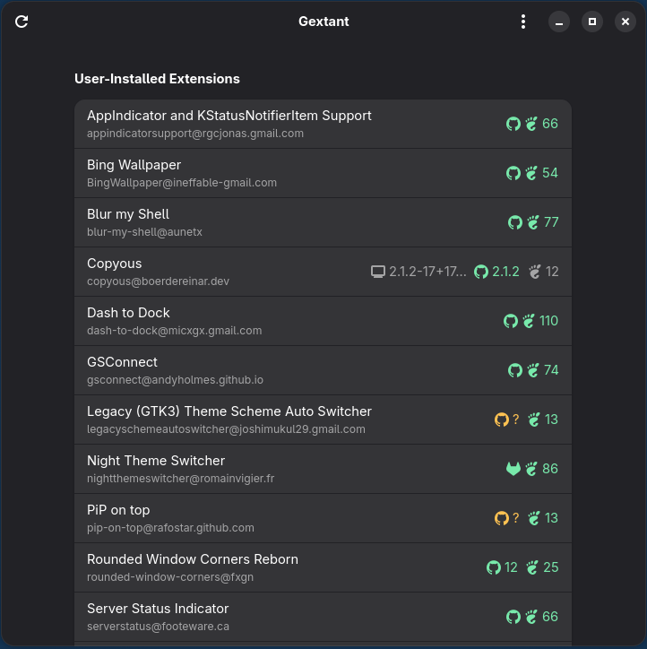

<p align="center">
  
</p>

<h1 align="center">Gextant</h1>

<p align="center">Keeps your GNOME Shell extensions up to date, straight from their repositories.</p>

<p align="center">
  <a href="LICENSE"></a>
  <a href="https://github.com/AperteDev/gextant/actions/workflows/ci.yml"></a>
  <a href="https://github.com/AperteDev/gextant/releases/latest"></a>
</p>

Gextant is an app for the GNOME desktop that lists your GNOME Shell extensions and tells you when
a newer version is out, without waiting for the review on extensions.gnome.org. It finds each
extension's repository from its own `metadata.json`, reads the latest release from GitHub or
GitLab, and compares it with what is installed and with what extensions.gnome.org has, so you see
at a glance when the portal is behind.

Gextant is at an early stage: it lists your extensions and checks them for updates, but it does
not install or update anything yet; that is next (see the [roadmap](docs/ROADMAP.md)).

Gextant is developed in my free time. If it keeps your extensions fresh, you can support its
development:

<p align="center">
  <a href="https://ko-fi.com/N5E229GJPZ"></a>
  <a href="https://github.com/sponsors/SelfRef"></a>
  <a href="https://liberapay.com/SelfRef/donate"></a>
</p>

## Screenshots



Each place that has a version shows as its icon and number: GitHub, GitLab, or the GNOME mark for
extensions.gnome.org. Green means what you have is current, blue that the place has something
newer, grey that the two cannot be compared, and a yellow `?` that the place has no version to
give (the tooltip says why).

## Features

- Your extensions in a list: the ones you installed, then the system's, each with its name, UUID
  and version.
- Checked for new versions when Gextant starts and from the refresh button, against the
  extension's repository and, separately, extensions.gnome.org.
- The repository is found from the extension's `metadata.json`: GitHub and GitLab projects
  (gitlab.com, and hosts such as `gitlab.gnome.org`), their project pages, and websites that link
  to the repository.
- Places that agree on a version share one chip, so a repository ahead of the portal shows as two
  and you see when it is behind.
- Repositories are read from the forges' own pages, so a check costs no API quota; what was found
  is kept for a few hours, so starting the app does not ask everything again.
- Optional GitHub and GitLab access tokens, kept in your keyring, for when a forge's limit is
  used up or a repository is private.

All of what Gextant does, and what it will, is listed in [FEATURES.md](docs/FEATURES.md).

## Getting started

Gextant needs GNOME 48 or newer. Install it from:

- **Arch Linux (AUR):** [`gextant`](https://aur.archlinux.org/packages/gextant) (built from the
  release), [`gextant-bin`](https://aur.archlinux.org/packages/gextant-bin) (the release's
  binary) or [`gextant-git`](https://aur.archlinux.org/packages/gextant-git) (the latest commit).
- **Debian and Ubuntu:** the `.deb` of the [latest release](https://github.com/AperteDev/gextant/releases/latest)
  (built for Ubuntu 26.04).
- **Any other distribution:** the release's tarball, extracted into `/`, or
  [build it from source](#building).

Then open Gextant: it lists your extensions and starts checking them.

## Development

### Building

**Dependencies:** Rust (stable), GTK 4.14+, libadwaita 1.7+, libsecret, `blueprint-compiler` and
`glib-compile-resources` (GLib).

```sh
cargo run --release
```

`make install` installs it for the current user (`~/.local`), `make uninstall` removes it.

Every push is checked by [CI](.github/workflows/ci.yml); releases are made by the manual
[Release](.github/workflows/release.yml) workflow and listed in the
[changelog](docs/CHANGELOG.md).

## License

[GPL-3.0-or-later](LICENSE)
